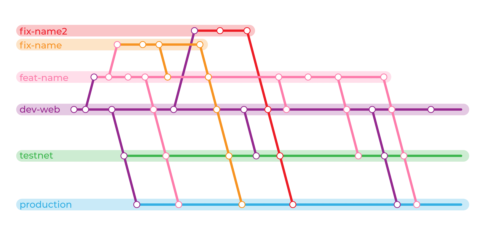

# NewSwap Web

Website: [newswap.org](https://newswap.org/)

## Requirements

Use a supported Node.js 22 or newer LTS release (`nvm use`). Node.js 16 is no longer supported.

## Install Dependencies

```bash
npm ci
```

## Environments

**Dev:** `.env`

**Production:** `.env.production`

## Development

```bash
npm run dev
```

Both development and production use mainnet configuration.

- `npm run dev:production`

## Build

```bash
npm run build
```

_Default_ build is **MainNet**

- `npm run build:dev`

- `npm run build:production`

### Run Build

```bash
npm run start
```

Run with last build

## Export HTML files

Create a build and export it's static HTML files to **html** folder

```bash
npm run export
```

_Default_ export is **MainNet**

- `npm run export:dev`

- `npm run export:production`

## Branches



## Contributing

#### Localization

Translation Files: **./public/locales/\*.json**

## Formatting Your Code

Always check your code before making a commit. Some useful tools integrated in this project.

**Lint** (Eslint)

```bash
npm run lint
```

**Formatting Check** (Prettier)

```bash
npm run fc
```

**Formatting Fix** (Prettier)

```bash
npm run ff
```

## Dependency maintenance

Use npm and commit `package-lock.json`. Install reproducibly with `npm ci`; do not mix Yarn and npm lockfiles.

Run `npm audit`, `npm run lint`, and `npm run build:dev` after dependency updates. Check both desktop and mobile pages, navigation, language switching, Markdown content, and image loading.

The project preserves Bootstrap 4.5.2 CSS and uses React 18 for component compatibility. Webpack's built-in asset modules replace `next-images` and `raw-loader`.

`npm run export:dev` and `npm run export:production` produce the static site directly in `html/` with Next.js `output: "export"`; the removed `next export` command is no longer needed. Use `npm run build:<environment>` and `npm start` for a Node server deployment.

Only mainnet is supported. `.env` and `.env.production` contain mainnet settings.
